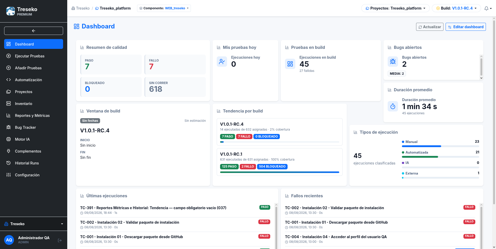
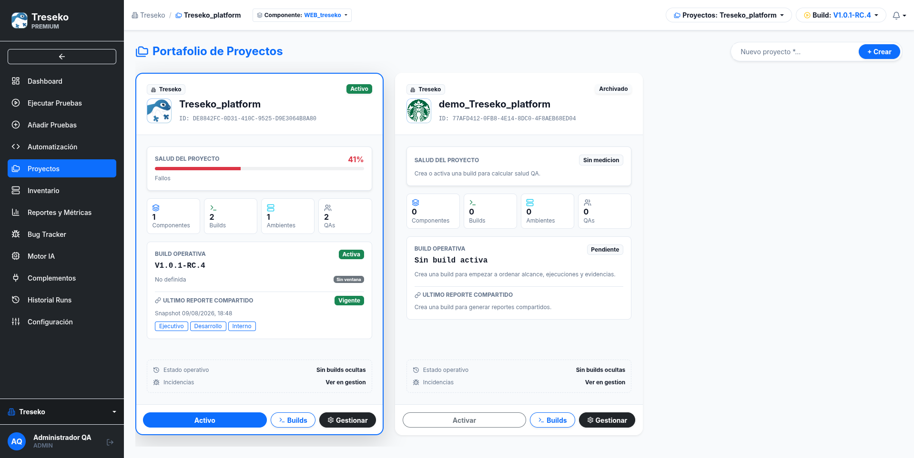
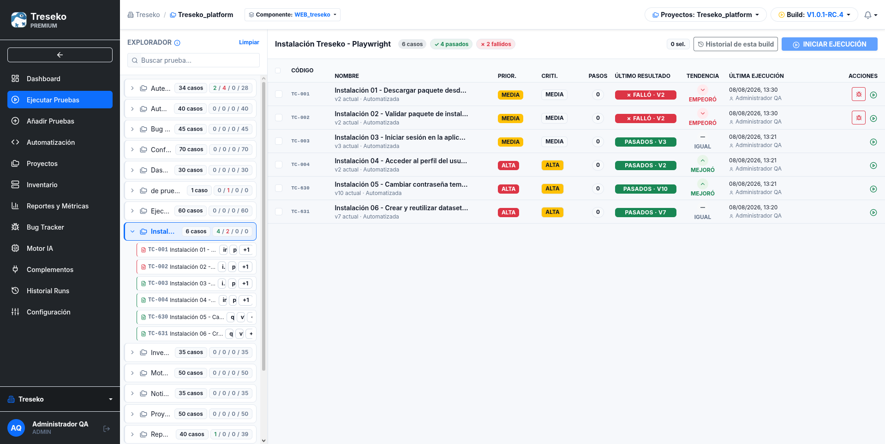
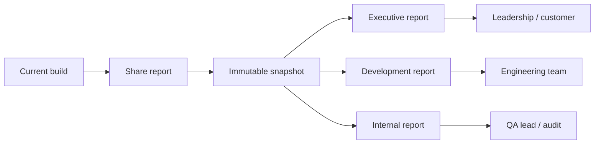
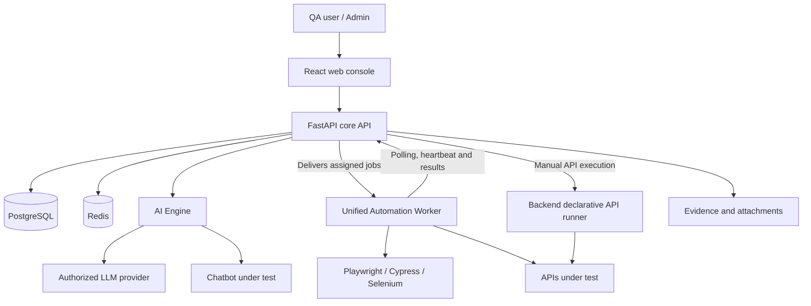

# Treseko Platform

[](VERSION)
[](#editions)
[](LICENSE)
[](backend/)
[](frontend/)
[](docs/en/DATABASE.md)
[](automation-worker/)

**Treseko Community** is an open-source QA platform for software teams. Organize test cases, executions, evidence and bugs in one self-hosted workspace, with traceability to help teams make release decisions.

[Documentación en español](README.md) · [English documentation index](docs/en/README.md)

Treseko Community is designed for QA, development and product teams that want a self-managed, auditable workspace with a path to additional Premium capabilities when needed.

## Treseko 1.0.8

- Review automated run results, failure details and script locations from the execution monitor.
- Retain Playwright traces when available and inspect diagnostics and evidence supplied by supported runners.
- Import browser journeys recorded with the optional Treseko Flow extension, then review and save them as test cases. Flow is distributed separately and is not included in this package.
- Report results from external runners through the API. Community includes basic reporting under a shared weekly quota; Premium can provide higher licensed limits.
- Update compatible installations with validation, backups, activation checks and recovery. Follow the version-specific instructions before upgrading.

See the [changelog](CHANGELOG.en.md) for the complete release history.

## Screenshots

The [gallery](screenshots/README.en.md) contains 33 screenshots with synthetic data from Treseko 1.0.4. Some screens may differ from the current version.

Reference views from Treseko Community 1.0.4:

<p align="center">
  <a href="screenshots/dashboard.png"></a>
  <a href="screenshots/proyectos.png"></a>
  <a href="screenshots/ejecutar-pruebas.png"></a>
</p>

## Why Treseko

Teams often combine spreadsheets, issue trackers, evidence folders, manual reports and disconnected automation. Treseko brings that QA work together:

| Need | Common approach | Treseko |
| --- | --- | --- |
| Test cases | Spreadsheets or isolated test managers | Hierarchical suites, versioned cases and builds |
| Manual execution | Evidence scattered across tools | Steps, results, snapshots and attachments per execution |
| Bugs | Tickets without QA context | Internal Bug Tracker linked to cases, builds, evidence and owners |
| Automation | External jobs that are hard to trace | Approved workers, jobs and results linked to QA records |
| Reporting | Manual reports and screenshots | Dashboard, build metrics and shareable reports |
| AI | Separate tools | AI Engine integrated with the execution and analysis flow |
| Governance | Broad permissions | Capability-based RBAC and Community/Premium gates |

## Workflow

The functional workflow in Treseko Community is:

```mermaid
flowchart TB
  A[Solution / Customer] --> B[QA Project]
  B --> C[Component]
  C --> D[Build]
  D --> E[Shared suites]
  E --> FC[CLASSIC cases]
  E --> FA[API cases]
  E --> FCH[CONVERSATIONAL cases]
  E -. reserved .-> FP[PERFORMANCE]
  FC --> MC[Manual / Automation Worker / AI Engine]
  FA --> MA[Manual / Automation Worker (declarative API)]
  FCH --> MCH[Manual / Automated or AI Engine when workflow is enabled]
  MC --> X[Persisted executions]
  MA --> X
  MCH --> X
  X --> G[Evidence]
  X --> H[Bug Tracker and Incident Center]
  G --> I[Snapshot reports]
  H --> I
  I --> J[Release decision]
```

**API + AI** is not presented as generally available; it depends on verifying
that the installation has a certified execution path. `PERFORMANCE` remains
reserved and has no load-test executor in this version.

## QA workflow participants

Treseko organizes information around the people who need to use it:

| Participant | What they do in Treseko | What they get |
| --- | --- | --- |
| Manual QA | Run steps, attach evidence and report failures | Execution console and case traceability |
| QA automation | Connect workers, scripts and automated runs | Results linked to builds, suites and cases |
| QA lead | Review coverage, failures, blocks and release risk | Dashboard and build reports |
| Development | Investigate bugs with technical context and evidence | Development report and Bug Tracker |
| Management / customer | Review status, risk and recommendations | Shareable executive report |
| Internal team | Audit decisions, snapshots and traceability | Internal report with operational details |

### Reports and snapshots

Reports are generated as snapshots of a build. This preserves a stable view of QA status while the team continues working on another version.



Each report answers a different question:

- **Executive:** Is the build ready? What is the risk, and what blocks release?
- **Development:** Which failures, bugs and evidence should the technical team review?
- **Internal:** Which decisions, data and traceability support the QA result?

## Architecture

Operational architecture of Treseko Community:



## Repository components

- `frontend/`: React/Vite web console.
- `backend/`: main FastAPI API, RBAC, data, reports, bugs and edition gates.
- `engine/`: AI-assisted execution engine.
- `automation-worker/`: local or remote runner for Playwright, Cypress, Puppeteer and Selenium, with declarative API testing support.
- `scripts/`: public installation scripts.
- `docs/`: technical, operational and API documentation.

Treseko's private commercial services are not part of this public repository.

## Main capabilities

- Solutions, projects, components and builds.
- Hierarchical suites with colors/icons and versioned cases.
- Manual execution with steps, snapshots and statuses.
- API cases with declarative contracts, assertions, variables and evidence.
- Conversational cases with turns, memory, tools and evaluation.
- Attachments and evidence per execution.
- Internal Bug Tracker with QA context.
- Quality dashboard with trends, duration and coverage.
- Build reports, shareable snapshots and traceability.
- Case portability through the official `.tcases` package, versioned import profiles and auditable rollback for eligible batches.
- Requirements, user stories and acceptance criteria linked to cases and execution coverage.
- Automation workers approved through pairing.
- AI Engine integration for execution and analysis.
- Governed MCP for querying QA context, running confirmed operations and importing cases through preview/commit/rollback according to scopes and allowlists.
- Granular roles, permissions and capabilities.
- Community edition with unavailable Premium features clearly shown as locked.
- Self-hosted installation with Docker.

## Editions

Treseko uses the same product across editions. Community is free and self-hosted. A signed Premium license expands capabilities and limits without requiring a reinstall or data migration.

| Edition | Intended for | Includes |
| --- | --- | --- |
| Community | Teams that want to organize QA, automate and use AI on their own infrastructure. | Solutions, projects, cases, builds, manual execution, basic Bug Tracker with evidence, basic reports, local automation, declarative API tests through the unified worker, and basic external result reporting under a shared quota of 50 executions per rolling seven-day window. AI Engine and Community updates are subject to their limits. |
| Premium | Teams that need additional capabilities or higher limits. | Enables only the capabilities and quotas in the installed signed license. These may include advanced RBAC, multiple workers, higher automation and external reporting quotas, snapshots, integrations or other Premium features. |

The public runtime recognizes `community` and `premium` editions. Specific commercial names, packages and commitments are defined outside this repository. Feature availability depends on the capabilities and limits in the signed license, RBAC permissions and instance configuration.

To install or review a license, open **Settings → License**. Unavailable features are shown as locked without exposing technical errors to users.

## Download

You can clone the source code or check [packages published on GitHub Releases](https://github.com/treseko/treseko-platform/releases). To clone the repository:

Linux/macOS:

```bash
git clone https://github.com/treseko/treseko-platform.git
cd treseko-platform
```

Windows PowerShell:

```powershell
git clone https://github.com/treseko/treseko-platform.git
cd treseko-platform
```

## Quick start

Requirements:

- Docker 24+
- Docker Compose v2
- Linux is recommended for production installations

### Install locally

Linux/macOS:

```bash
scripts/install_local_treseko.sh --http-port 9095
```

Windows PowerShell:

```powershell
.\scripts\install_local_treseko.ps1 -HttpPort 9095
```

Graphical desktop installers are temporarily excluded from this release. Use the included Bash or PowerShell scripts and see the [installation guide](docs/en/INSTALLATION.md) for available installation methods and requirements.

For local demo data only:

```bash
scripts/install_local_treseko.sh --with-demo
```

The local installer generates secrets, starts Docker Compose, creates the initial administrator and displays a temporary password. Change that password at first login.

### Update an existing installation

Do not update a running installation with `git pull` and `docker compose up --build`. The procedure depends on the installed version and deployment topology. For a compatible Compose installation, download the target release package and follow the [installation and update guide](docs/en/INSTALLATION.md). Do not delete volumes or secrets as part of an update. For the legacy Docker migration from 1.0.7 to 1.0.8, also follow the [specific migration guide](docs/en/UPDATE_EXISTING_INSTALLATION_DOCKER.md).

### Install on a server over SSH

> The remote installer passes secrets in SSH arguments and is not recommended for production. For production, prefer [manual installation with secrets supplied through files](docs/en/INSTALLATION.md).

From Linux:

```bash
scripts/install_remote_treseko.sh user@server --http-port 9095
```

From Windows PowerShell:

```powershell
.\scripts\install_remote_treseko.ps1 user@server -HttpPort 9095
```

The remote installer uploads the project, generates secrets, runs migrations and creates the initial administrator. It prints the URL, initial username and temporary password. It only installs to a new destination; if the selected directory is not empty, it stops without overwriting files. The target host must run Linux. Windows can be used as the client that launches the SSH installation.

### Manual installation

The repository includes a `.env.production.example` template without secrets. For full control, follow the [manual installation guide](docs/en/INSTALLATION.md) to create `compose.production.env`, generate secrets outside Git, run migrations and create the first administrator.

## Clean installation

A clean production installation does not create solutions, projects, builds or demo data. After the first login, the administrator creates the first solution in the interface.

For local demos only:

```bash
docker compose -f docker-compose.prod.yml --env-file compose.production.env run --rm --entrypoint python backend /app/seed_demo_showcase.py
```

Do not run demo seeds in production.

## Automation

The Automation Worker is a separate process. The local installer starts it in Compose; use the following steps when running it as a standalone process on another machine. In V1, it is connected through approval in the console and identified by its token and heartbeat, not by IP address or port.

```bash
cd automation-worker
cp .env.example .env
npm install
npm start
```

The Worker displays a code such as `WK-123456`. Approve it under **Automation → Workers**. See the [Automation Worker guide](docs/en/AUTOMATION_WORKER_V1.md) for connection requirements and execution options.

## Integrated AI

Treseko connects the AI Engine to QA workflows. It can:

- assist with executions;
- generate compact analyses;
- help investigate failures;
- prepare traceability for reports;
- retain audit records and edition limits.

The backend, RBAC and system configuration govern execution and sensitive data.

## Documentation

Start with the [English documentation index](docs/en/README.md). It links to:

- [Quick installation](docs/en/INSTALLATION.md)
- [Docker guide](docs/en/DOCKER_GUIDE.md)
- [Local Linux development (contributors only)](docs/en/LINUX_SETUP.md)
- [Platform usage guides](docs/en/README.md#using-treseko)
- [Architecture](docs/en/ARCHITECTURE.md)
- [External automation reporting](docs/en/API_USAGE_GUIDE.md)
- [Authentication and RBAC](docs/en/AUTH_RBAC_GUIDE.md)
- [Edition strategy](docs/en/EDITION_STRATEGY.md)
- [Automation Worker V1](docs/en/AUTOMATION_WORKER_V1.md)
- [Updating remote Automation Workers](docs/en/AUTOMATION_WORKER_REMOTE_UPDATES.md)
- [Updating a remote Engine](docs/en/ENGINE_REMOTE_UPDATES.md)
- [Treseko Flow](docs/en/TRESEKO_FLOW_GUIDE.md)
- [External automation API contract](docs/en/EXTERNAL_AUTOMATION_API.md)
- [Test formats and execution modes](docs/en/TEST_TYPES_AND_EXECUTION.md)
- [API testing](docs/en/API_TESTING_GUIDE.md)
- [Conversational testing](docs/en/CONVERSATIONAL_TESTING_GUIDE.md)
- [Incident Center](docs/en/INCIDENT_CENTER_GUIDE.md)
- [Case portability](docs/en/CASE_PORTABILITY.md)
- [Import compatibility](docs/en/CASE_IMPORT_COMPATIBILITY.md)
- [AI Engine configuration](docs/en/AI_ENGINE_CONFIG.md)

## Repository hygiene

This public tree intentionally excludes:

- local `.env` files;
- generated logs;
- local databases and backups;
- private commercial services;
- private keys or sensitive tooling;
- internal audits;
- adversarial lab evidence;
- development notes and temporary plans.

## Version

Application version: `1.0.8`.

See the [changelog](CHANGELOG.en.md) for changes in this version.

## Repository license

Treseko Community is distributed under the **GNU Affero General Public License v3.0 or later** (`AGPL-3.0-or-later`). See [LICENSE](LICENSE).

Private commercial services, Premium infrastructure, authority services, commercial operations and sensitive material are not part of this public repository.

The Treseko name, logos and visual identity are governed by [TRADEMARKS.md](TRADEMARKS.md). The code license does not grant permission to use the brand in a way that suggests affiliation, endorsement or an official channel.
