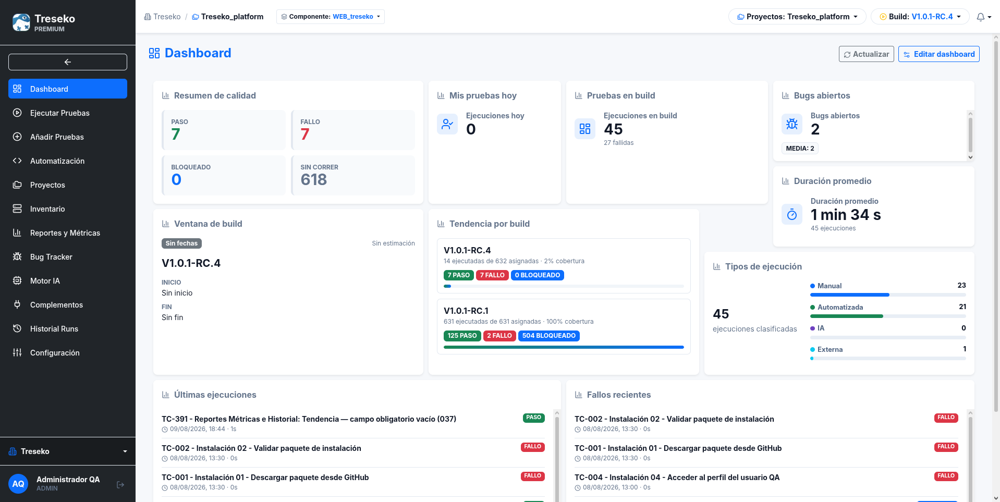
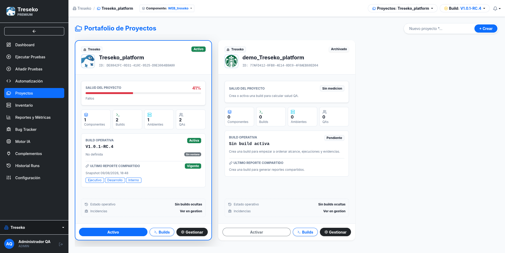
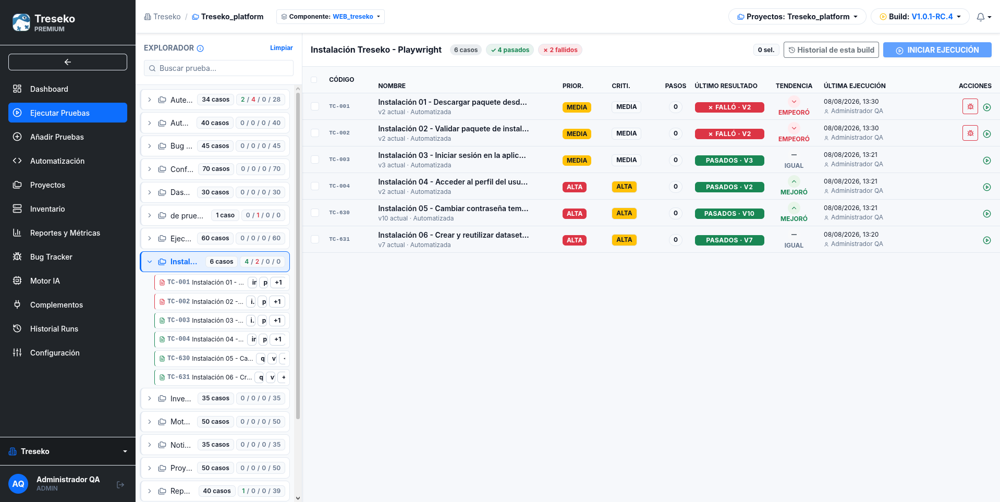
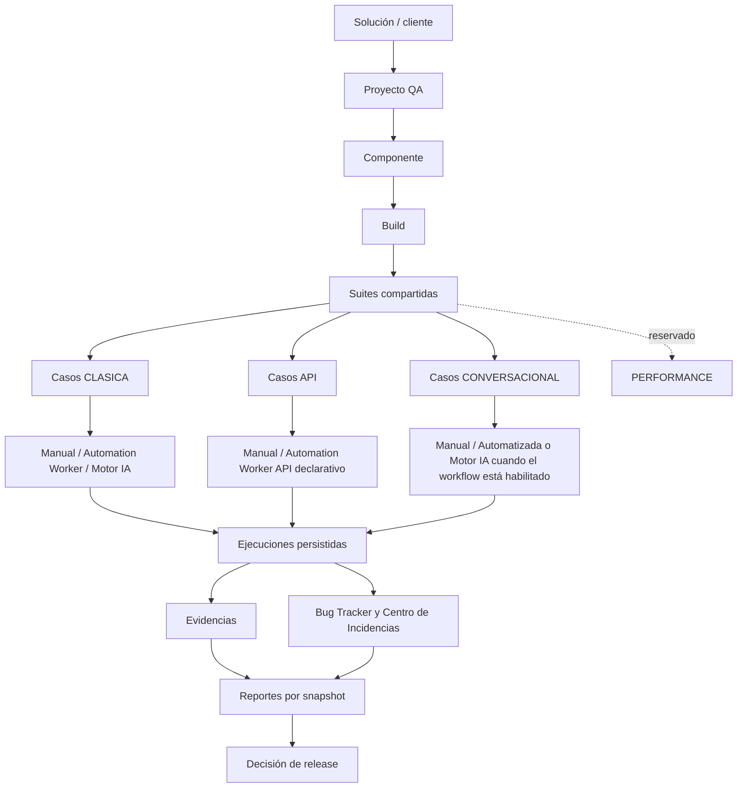
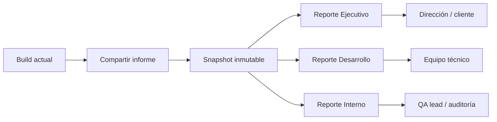
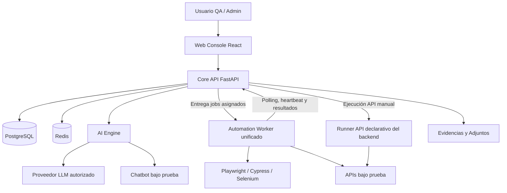

# Treseko Platform

[](VERSION)
[](#ediciones)
[](LICENSE)
[](backend/)
[](frontend/)
[](docs/DATABASE.md)
[](automation-worker/)

**Treseko Community** es un gestor de pruebas de software de código abierto para equipos QA y desarrollo. Organizá casos de prueba, ejecuciones, evidencias y bugs en un solo lugar; instalalo en tu propio servidor con Docker y conservá la trazabilidad necesaria para decidir cada release con contexto.

[English version](README.en.md)

La edición Community está pensada para equipos de QA, desarrollo y producto que buscan una instalación limpia, auditable y lista para crecer hacia capacidades Premium cuando corresponda.

### Novedades de Treseko 1.0.8

- El seguimiento de ejecuciones automatizadas muestra el resultado y permite revisar el detalle del error y la ubicación de la línea del script.
- Las ejecuciones Playwright pueden conservar una traza consultable para investigar interacciones y fallos.
- La ubicación del error se relaciona con el script original en los formatos compatibles.
- El editor recibe scripts grabados con la extensión Treseko Flow para revisarlos y guardarlos como casos.
- Treseko Flow es opcional y se distribuye por separado; no está incluido en este paquete.
- La API permite informar resultados de ejecuciones externas: Community tiene una cuota semanal compartida y Premium puede ofrecer límites mayores según la licencia.
- La pantalla de actualizaciones identifica instalaciones sin coordinador atómico y evita aplicar un paquete incompatible; indica usar el instalador de actualización en el equipo host.

Para ver el historial de cambios de todas las versiones, consultá el
[changelog](CHANGELOG.md).

Podés ver capturas de las principales secciones en la [galería de capturas](screenshots/README.md).
Son imágenes de referencia de Treseko Community 1.0.4 con datos sintéticos;
no representan necesariamente la interfaz de 1.0.8.

### Vista rápida

Vistas de referencia de Treseko Community 1.0.4:

<p align="center">
  <a href="screenshots/dashboard.png"></a>
  <a href="screenshots/proyectos.png"></a>
  <a href="screenshots/ejecutar-pruebas.png"></a>
</p>

> **Conocé Treseko, sus ediciones y la propuesta de producto en la [landing oficial de Treseko](https://treseko.com).**

- Sitio oficial: [treseko.com](https://treseko.com)
- Web del mantenedor: [biuler.com](https://www.biuler.com)
- Mantenedor: [José Manuel Zúñiga](https://www.linkedin.com/in/jose-manuel-zuniga/)
- Contacto: [jose@treseko.com](mailto:jose@treseko.com)
- Términos y condiciones: [treseko.com/terminos-y-condiciones](https://treseko.com/terminos-y-condiciones)
- Licencia del código Community: [AGPL-3.0-or-later](LICENSE)

Este repositorio público contiene la edición Community bajo AGPL. Los servicios
comerciales y la infraestructura de licencias no forman parte de esta publicación.


## Por qué Treseko

Muchas organizaciones terminan combinando planillas, Jira, carpetas de evidencias, reportes manuales y automatizaciones sueltas. Treseko unifica ese flujo en una sola consola:

| Necesidad | Herramientas tradicionales | Treseko |
|---|---|---|
| Casos de prueba | Planillas o test managers aislados | Suites jerárquicas, casos versionados y builds |
| Ejecución manual | Evidencia dispersa y poco contexto | Pasos, resultados, snapshots y adjuntos por ejecución |
| Bugs | Tickets sin contexto QA completo | Bug tracker interno con caso, build, evidencia y responsable |
| Automatización | Jobs externos difíciles de rastrear | Workers aprobados, jobs y resultados vinculados a QA |
| Reportes | Informes manuales o capturas aisladas | Dashboard, métricas de build y reportes compartibles |
| IA | Herramientas separadas | Motor IA integrado al flujo de ejecución y análisis |
| Gestión | Permisos generales | RBAC por capacidades y gates Community/Premium |

## Flujo de trabajo

Flujo funcional de Treseko Community:



La modalidad **API + IA** no se presenta como general: depende de verificar
que la instalación tenga una ruta certificada. `PERFORMANCE` permanece
reservado y no tiene ejecutor de carga en esta versión.

## Participantes del flujo de QA

Treseko ordena el trabajo según quién necesita consultar la información:

| Participante | Qué hace en Treseko | Qué recibe |
|---|---|---|
| QA manual | Ejecuta pasos, adjunta evidencias y reporta fallos | Consola de ejecución y trazabilidad por caso |
| QA automation | Vincula workers, scripts y ejecuciones automatizadas | Resultados ligados a build, suite y caso |
| QA lead | Revisa cobertura, fallos, bloqueos y riesgo de release | Dashboard y reportes de build |
| Desarrollo | Analiza bugs con contexto técnico y evidencia | Reporte de desarrollo y Bug Tracker |
| Dirección / cliente | Revisa estado, riesgo y recomendación | Reporte ejecutivo compartible |
| Equipo interno | Audita decisiones, snapshots y trazabilidad | Reporte interno con detalle operativo |

### Reportes y snapshots

Los reportes se generan como snapshots de una build. Así se conserva una vista
estable del estado de QA aunque el equipo continúe trabajando en otra versión.



Cada tipo de reporte responde una pregunta distinta:

- **Ejecutivo**: si la build está lista, qué riesgo tiene y qué bloquea el release.
- **Desarrollo**: qué fallos, bugs y evidencias necesita revisar el equipo técnico.
- **Interno**: qué decisiones, datos y trazabilidad sostienen el resultado de QA.

## Arquitectura

Arquitectura operativa de Treseko Community:



## Componentes del repositorio

- `frontend/`: consola web React/Vite.
- `backend/`: API principal FastAPI, RBAC, datos, reportes, bugs y controles por edición.
- `engine/`: motor de ejecución asistida por IA.
- `automation-worker/`: runner local o remoto para Playwright, Cypress, Puppeteer y Selenium, con capacidad para pruebas API declarativas.
- `scripts/`: scripts publicos de instalacion.
- `docs/`: documentación técnica, operativa y de API.

Los servicios comerciales privados de Treseko no forman parte de este repositorio público.

## Capacidades Principales

- Soluciones, proyectos, componentes y builds.
- Suites jerarquicas con colores/iconos y casos versionados.
- Ejecución manual con pasos, snapshots y estados.
- Casos API con contratos declarativos, aserciones, variables y evidencia.
- Casos conversacionales con turnos, memoria, herramientas y evaluación.
- Adjuntos y evidencias por ejecucion.
- Bug tracker interno con contexto QA.
- Dashboard de calidad, tendencia, duración y cobertura.
- Reportes de build, snapshots compartibles y trazabilidad.
- Portabilidad de casos con paquete oficial `.tcases`, perfiles de importación
  versionados y reversión auditable de lotes elegibles.
- Requisitos, historias y criterios de aceptación vinculados con casos y su
  cobertura de ejecución.
- Workers de automatización aprobados por código.
- Integración con motor IA para ejecución y análisis.
- MCP gobernado para consultar contexto QA, ejecutar operaciones confirmadas e
  importar casos con preview/commit/rollback según scopes y allowlist.
- Roles, permisos y capacidades granulares.
- Edición Community con funciones Premium visibles como bloqueadas.
- Instalación self-hosted con Docker.

## Ediciones

Treseko usa el mismo producto en todas las ediciones. Community es gratuito y
self-hosted; una licencia Premium firmada amplía capacidades y límites sin
obligar a reinstalar ni mover los datos.

| Edición | Pensada para | Incluye |
|---|---|---|
| Community | Equipos que quieren ordenar QA, automatizar y usar IA en su propia infraestructura. | Soluciones, proyectos, casos, builds, ejecuciones manuales, Bug Tracker básico con evidencias, reportes básicos, automatización local, API declarativa mediante el worker unificado y reporte externo básico con una cuota compartida de 50 ejecuciones por ventana móvil de siete días. Incluye Motor IA y actualizaciones Community dentro de sus límites. |
| Premium | Equipos que necesitan ampliar capacidades o límites. | Habilita únicamente las capacidades y cuotas incluidas en la licencia firmada instalada; pueden abarcar RBAC avanzado, múltiples workers, una cuota superior para automatización y reportes externos, snapshots, integraciones u otras funciones Premium. |

La edición reconocida por el runtime público es `community` o `premium`. Los
nombres, paquetes y compromisos comerciales específicos se definen fuera de
este repositorio. La disponibilidad final de cada función depende de las
capacidades y límites firmados en la licencia, los permisos RBAC y la
configuración de la instancia.

Para instalar o revisar una licencia, abrí **Configuración → Licencia**. Las
funciones no habilitadas se muestran como bloqueadas de forma clara, sin
exponer errores técnicos al usuario.

## Descarga

Podés clonar el código fuente o revisar los [paquetes publicados en GitHub Releases](https://github.com/treseko/treseko-platform/releases). Para clonar el repositorio y entrar en la carpeta creada:

Desde Linux/macOS:

```bash
git clone https://github.com/treseko/treseko-platform.git
cd treseko-platform
```

Desde Windows PowerShell:

```powershell
git clone https://github.com/treseko/treseko-platform.git
cd treseko-platform
```

## Inicio rápido

Requisitos:

- Docker 24+
- Docker Compose v2
- Linux recomendado para instalaciones productivas

### Probar en local

Desde Linux/macOS:

```bash
scripts/install_local_treseko.sh --http-port 9095
```

Desde Windows PowerShell:

```powershell
.\scripts\install_local_treseko.ps1 -HttpPort 9095
```

### Instalación por script

Los instaladores gráficos para escritorio están temporalmente fuera de esta
versión. La instalación se realiza con los scripts Bash y PowerShell incluidos;
consultá [Instalación](docs/INSTALLATION.md) para elegir el flujo y revisar sus
requisitos.

Con datos demo:

```bash
scripts/install_local_treseko.sh --with-demo
```

El instalador local genera secretos, levanta Docker Compose, crea el admin inicial y muestra una contraseña temporal.

### Actualizar una instalación existente

No actualices una instalación en uso con `git pull` y `docker compose up --build`.
El procedimiento depende de la versión instalada y de la topología. Para una
instalación Compose compatible, descarga el paquete de la versión destino y
seguí la [guía de instalación y actualización](docs/INSTALLATION.md). La guía
explica el flujo sobre la instalación existente, los requisitos, las comprobaciones y los
límites de compatibilidad; no borres volúmenes ni secretos como parte de la
actualización. Para la migración de una instalación Docker legacy 1.0.7 a
1.0.8, consultá además la [guía específica de migración](docs/UPDATE_EXISTING_INSTALLATION_DOCKER.md).

### Instalar en un servidor por SSH

> El instalador remoto transporta secretos mediante argumentos SSH y no se
> recomienda para producción. Para producción, preferí la
> [instalación manual con secretos por archivo](docs/INSTALLATION.md#instalación-manual).

Desde Linux:

```bash
scripts/install_remote_treseko.sh usuario@servidor --http-port 9095
```

Desde Windows PowerShell:

```powershell
.\scripts\install_remote_treseko.ps1 usuario@servidor -HttpPort 9095
```

El instalador remoto sube el proyecto al servidor, genera secretos, ejecuta
migraciones, crea el administrador inicial y devuelve el usuario y una
contraseña temporal. Solo instala en un destino nuevo; si la carpeta elegida ya
contiene archivos, se detiene sin sobrescribirlos. Para actualizar una
instalación existente, seguí la guía de actualización.

> El servidor de destino debe ser Linux. Windows puede usarse como equipo cliente para iniciar la instalación por SSH.

### Instalación manual

La publicación incluye una plantilla `.env.production.example` sin secretos. Si
necesitás controlar cada paso, seguí la [instalación manual documentada](docs/INSTALLATION.md#instalación-manual),
que explica cómo crear `compose.production.env`, generar los secretos fuera de
Git, ejecutar migraciones y crear el primer administrador.

## Instalación limpia

Una instalación productiva limpia no crea soluciones, proyectos, builds ni
datos de demostración. Después del primer inicio de sesión, el administrador
crea la primera solución desde la interfaz.

Para demos locales solamente:

```bash
docker compose -f docker-compose.prod.yml --env-file compose.production.env run --rm --entrypoint python backend /app/seed_demo_showcase.py
```

No ejecutes seeds demo en produccion.

## Automatización

El Automation Worker es un proceso separado. El instalador local lo inicia en Compose; si vas a ejecutarlo como proceso independiente en otro equipo, usa este flujo. En V1 se vincula mediante aprobación desde la consola y se identifica por token y heartbeat, no por IP ni por puerto.

```bash
cd automation-worker
cp .env.example .env
npm install
npm start
```

El worker muestra un código como `WK-123456`. Apruébalo desde
**Automatización → Workers**. Para conocer los requisitos de conexión y las
opciones de ejecución, seguí la [guía de Automation Worker](docs/AUTOMATION_WORKER_V1.md).

## IA integrada

Treseko no trata la IA como una herramienta externa aislada. El motor IA se conecta al flujo QA para:

- asistir ejecuciones;
- generar análisis compactos;
- ayudar a revisar fallos;
- preparar trazabilidad para reportes;
- conservar auditoría y límites por edición.

La ejecución y los datos sensibles siguen gobernados por el backend, RBAC y la
configuración del sistema.

## Documentación

Empieza por aqui:

- [Instalación rápida](docs/INSTALLATION.md)
- [Skill para asistentes de IA: instalación y validación](skills/treseko-installation/SKILL.md)
- [Guía Docker](docs/DOCKER_GUIDE.md)
- [Desarrollo local en Linux (solo contribución)](docs/LINUX_SETUP.md)
- [Guías de uso de la plataforma](docs/README.md#usar-treseko)
- [Arquitectura](docs/ARCHITECTURE.md)
- [Automatización externa](docs/API_USAGE_GUIDE.md)
- [Auth y RBAC](docs/AUTH_RBAC_GUIDE.md)
- [Estrategia de ediciones](docs/EDITION_STRATEGY.md)
- [Automation Worker V1](docs/AUTOMATION_WORKER_V1.md)
- [Actualización de Workers remotos](docs/AUTOMATION_WORKER_REMOTE_UPDATES.md)
- [Actualización del Engine remoto](docs/ENGINE_REMOTE_UPDATES.md)
- [Treseko Flow](docs/TRESEKO_FLOW_GUIDE.md)
- [Contrato de automatización externa](docs/EXTERNAL_AUTOMATION_API.md)
- [Tipos y modalidades de pruebas](docs/TEST_TYPES_AND_EXECUTION.md)
- [Pruebas API](docs/API_TESTING_GUIDE.md)
- [Pruebas conversacionales](docs/CONVERSATIONAL_TESTING_GUIDE.md)
- [Centro de Incidencias](docs/INCIDENT_CENTER_GUIDE.md)
- [Portabilidad de casos](docs/CASE_PORTABILITY.md)
- [Compatibilidad de importación](docs/CASE_IMPORT_COMPATIBILITY.md)
- [Configuración del Motor IA](docs/AI_ENGINE_CONFIG.md)
- [Publicacion](PUBLISHING.md)

## Higiene del repositorio

Este árbol público excluye intencionalmente:

- archivos `.env` locales;
- logs generados;
- bases de datos locales y backups;
- servicios comerciales privados;
- llaves privadas o tooling sensible;
- auditorias internas;
- evidencias adversariales de laboratorio;
- notas de desarrollo y planes temporales.

## Versión

Versión de la aplicación: `1.0.8`

Consultá el [changelog](CHANGELOG.md) para conocer las novedades de esta
versión.

## Licencia del repositorio

Treseko Community se publica bajo **GNU Affero General Public License v3.0 o posterior** (`AGPL-3.0-or-later`). Consulta [LICENSE](LICENSE).

Los servicios comerciales privados, infraestructura Premium, servicios de autoridad, operaciones comerciales y material sensible no forman parte de este repositorio público.

La marca Treseko, sus logotipos y su identidad visual se rigen por
[TRADEMARKS.md](TRADEMARKS.md). La licencia del código no concede permiso para
usar la marca de forma que sugiera afiliación, respaldo o un canal oficial.
